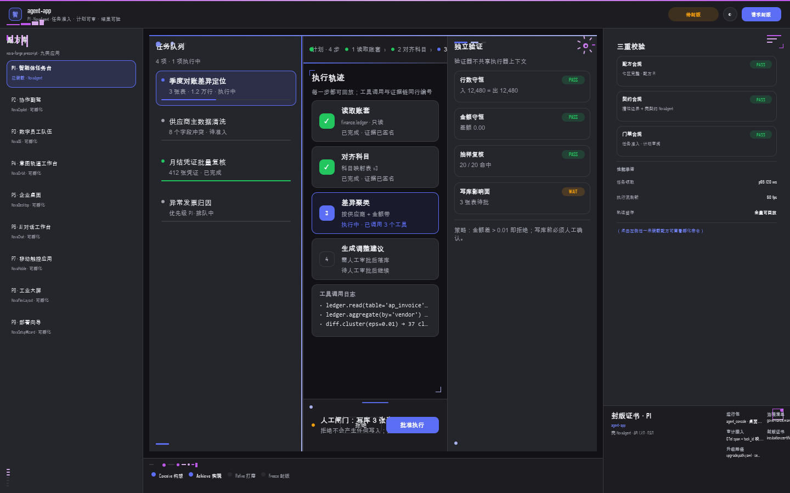
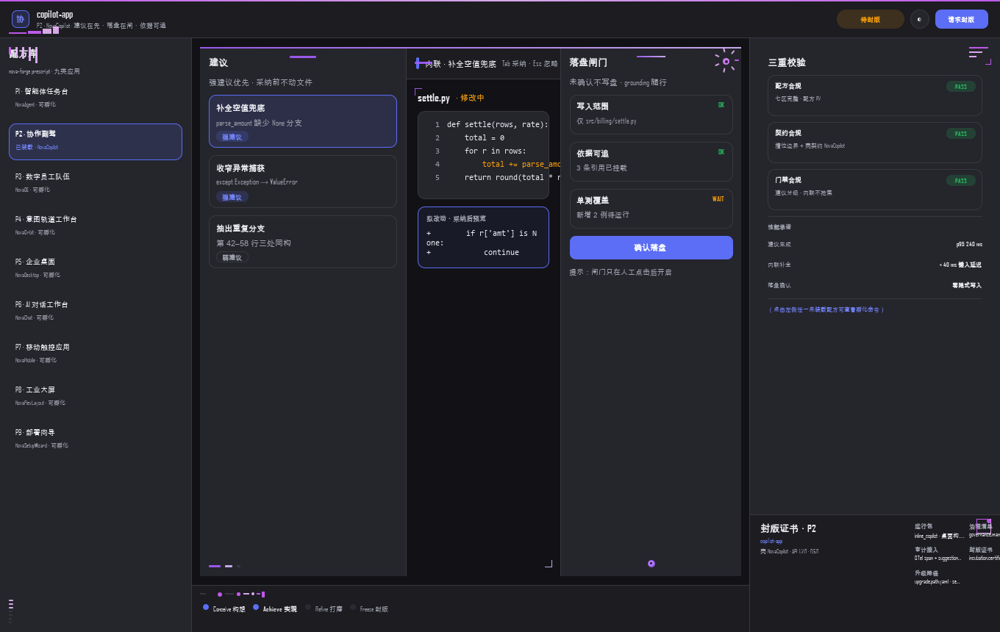
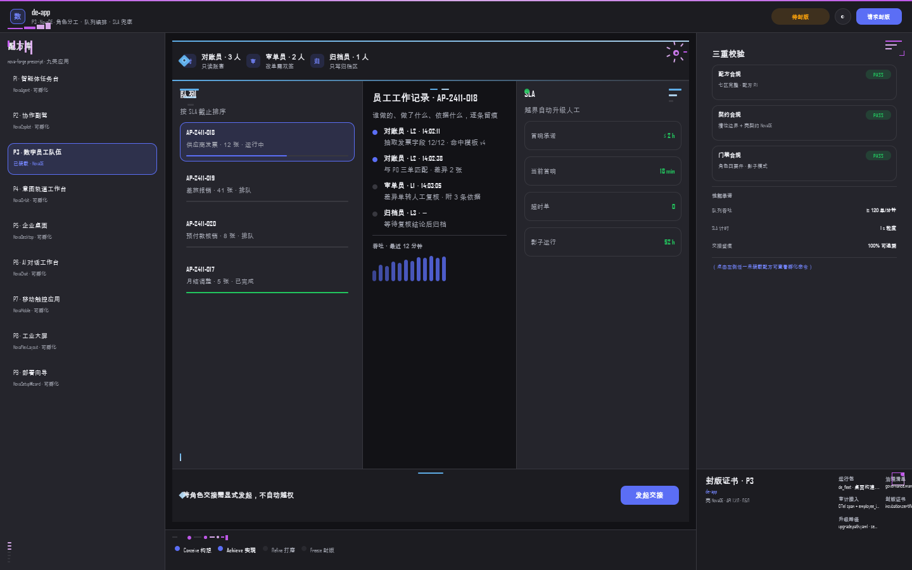
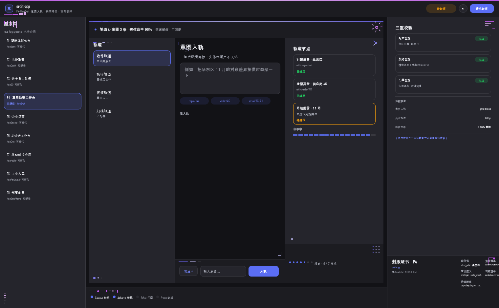
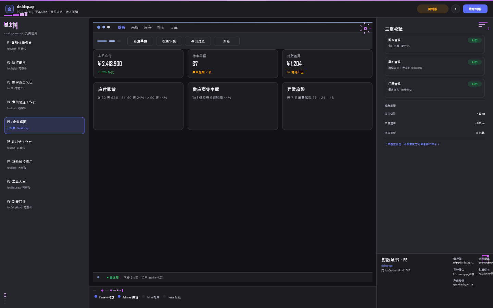
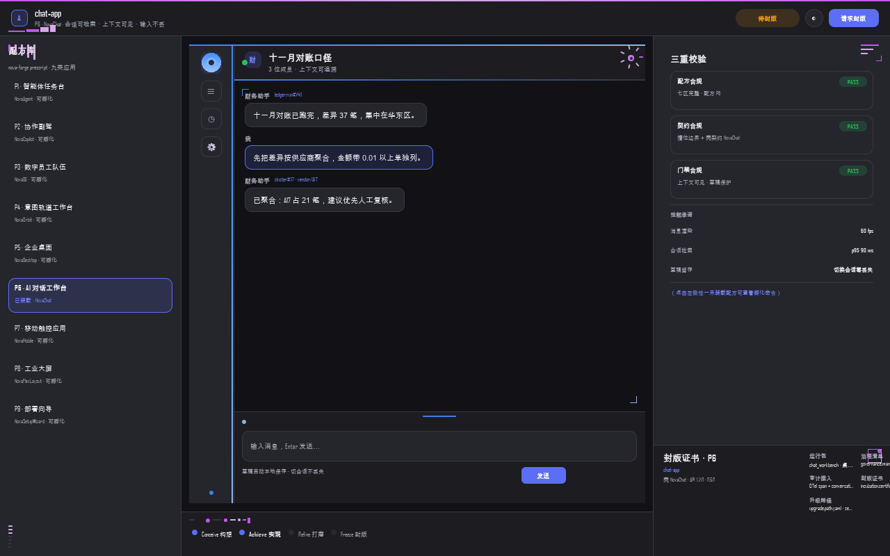
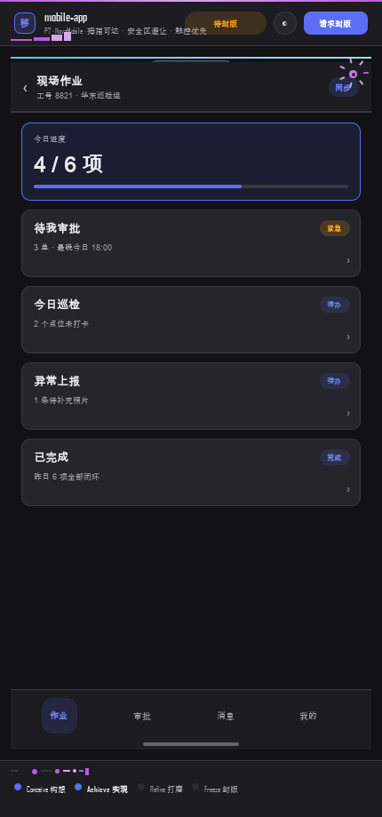
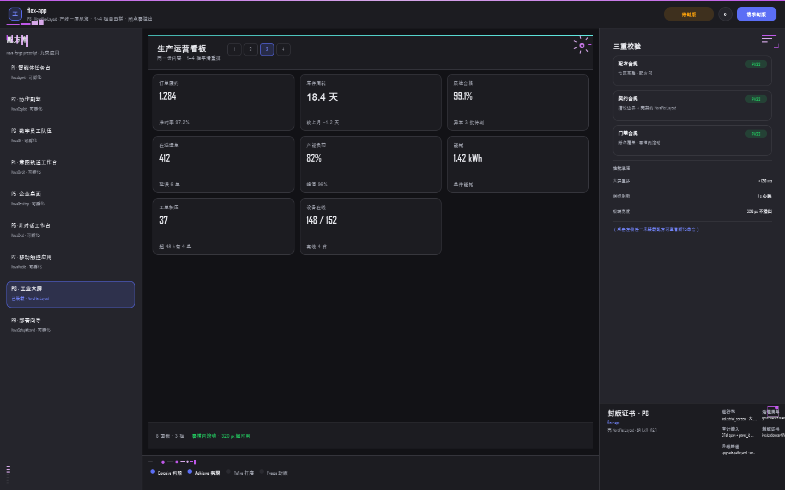
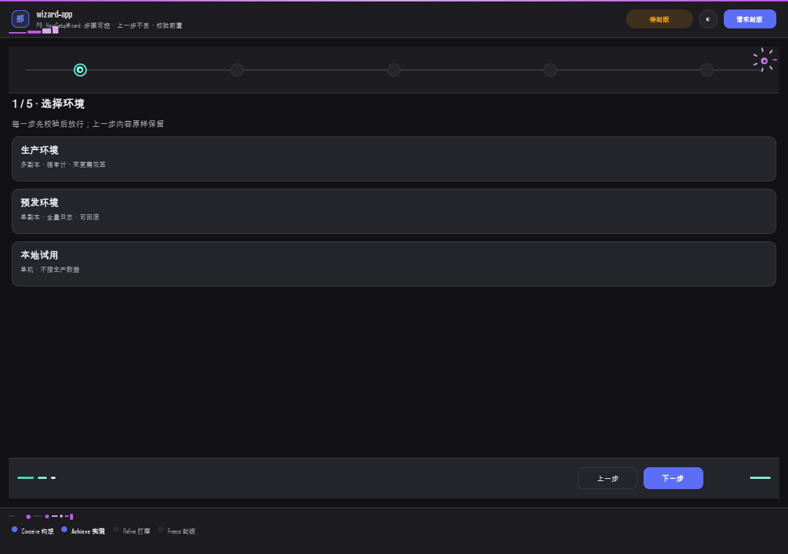

# 🧬 Prescript Gallery · 九类应用一键孵化

> `nova-forge prescript` —— 用 pyside-nova 的 **`NovaIncubator`** 七槽工作台，
> 把九个 Prescient Layout Shell 孵化成可直接运行的 PySide6 企业级应用。
> 版本：**nova-forge 0.6.0** · 依赖 **pyside-nova ≥ 1.2.0**（API 契约 1.2.0）。

## 一眼看懂

```bash
nova-forge prescript --list                          # 列出九类配方 P1–P9
nova-forge prescript --kind chat --path ./mei-chat   # 一键孵化 + 三重校验
cd mei-chat && python -m mei_chat.app               # 直接运行
```

每个生成物都是 **10 个文件**的完整工程：`pyproject.toml` / 双语启动器 /
`Main.qml`（孵化器七槽）/ `Stage.qml`（组合根业务舞台）/ `prescript.json`
（机器可读配方清单）/ README / 冒烟用例。封版必须人工点击确认闸门，脚本不自动签发证书。

## 九类配方

| 配方 | `--kind` | 应用 | 组合根（舞台） | 定位 |
|---|---|---|---|---|
| P1 | `agent` | 智能体任务台 | `NovaAgent` | 任务准入 · 计划可审 · 结果可验 |
| P2 | `copilot` | 协作副驾 | `NovaCopilot` | 建议在先 · 落盘在闸 · 依据可追 |
| P3 | `de` | 数字员工队伍 | `NovaDE` | 角色分工 · 队列编排 · SLA 兜底 |
| P4 | `orbit` | 意图轨道工作台 | `NovaOrbit` | 意图入轨 · 实体路由 · 画布收敛 |
| P5 | `desktop` | 企业桌面 | `NovaDesktop` | 菜单成树 · 页签成组 · 状态可读 |
| P6 | `chat` | AI 对话工作台 | `NovaChat` | 会话可检索 · 上下文可见 · 输入不丢 |
| P7 | `mobile` | 移动触控应用 | `NovaMobile` | 拇指可达 · 安全区避让 · 触控优先 |
| P8 | `flex` | 工业大屏 | `NovaFlexLayout` | 产线一屏尽览 · 1~4 栏自由拼 · 断点零溢出 |
| P9 | `wizard` | 部署向导 | `NovaSetupWizard` | 步骤可控 · 上一步不丢 · 校验前置 |

`NovaIncubator` 自身不参与九类（它是宿主），与 pyside-nova 20 个组合根口径一致。

## 七槽契约（每个生成物都完整）

| 槽 | 承载 |
|---|---|
| `globalSlot` | 应用身份 / 配方代号 / 专属-亮色切换 / 请求封版 |
| `recipeSlot` | 九类配方库（当前装载高亮，其余给出孵化命令） |
| `stageSlot` | 所选组合根的完整业务界面 |
| `validateSlot` | 三重校验 + 性能承诺 + 交互提示 |
| `pipelineSlot` | CARF 四阶段（构想 / 实现 / 打磨 / 封版） |
| `certificateSlot` | 封版证书 + 交付五件套 |
| `overlaySlot` | 人工确认闸门（只有点击才封版） |

## 实拍（Qt 离屏真实渲染，非示意图）

### P1 · 智能体任务台


### P2 · 协作副驾


### P3 · 数字员工队伍


### P4 · 意图轨道工作台


### P5 · 企业桌面


### P6 · AI 对话工作台


### P7 · 移动触控应用


### P8 · 工业大屏


### P9 · 部署向导


## 验收口径

- **9/9** 生成物离屏实跑：根对象存在、**0 QML ERROR**（`scripts/verify_prescript_app.py`）。
- **13 passed / 18 subtests**：`tests/test_prescript.py`（九配方 / 七槽 / 清单 / CLI 全路径）。
- 生成时三重校验：工程完整性 · Python 语法 · QML 结构 + 清单一致，全部 PASS 才提示完成。
- 舞台内组合根断点**按壳分档**：`agent` / `copilot` / `de` / `orbit` 设 480，保证在孵化器双栏之间仍展开自身左右槽；
  `chat` 设 700，三侧栏 + 中心区需要更宽，默认收起、窗口放大后自动展开（响应式，不挤压正文）。

## 边界

- 生成器只写本地工程；`push` / `tag` / PyPI 发布归维护者（CSA）。
- 生成物依赖 `pyside-nova` 的冻结契约 1.2.0，不改任何 QML / qmldir / 指纹。
- 舞台交互均为本地状态机，不联网、不隐式写盘。
